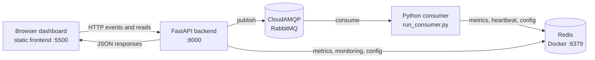

# StreamPulse

**StreamPulse** is a real-time library analytics and streaming-window metrics
aggregator. It accepts library actions such as issuing, returning, and
reserving a book, sends them through RabbitMQ, measures consumer processing
latency, aggregates that latency in tumbling and sliding windows, stores the
latest summaries in Redis, and displays the results in a browser dashboard.

The application separates event transport from processing. RabbitMQ buffers
events between the API and the consumer, while windows turn an event stream
into useful summaries without requiring the dashboard to process every event
itself.

## What the application does

The complete event flow is:

```text
Library Dashboard
       |
       v
FastAPI Backend -- publishes --> RabbitMQ queue
                                      |
                                      v
                              Python Consumer
                                      |
                                      v
                         Tumbling and Sliding Windows
                                      |
                                      v
                                  Redis
                                      |
                                      v
                         FastAPI Metrics API
                                      |
                                      v
                              Frontend Dashboard
```
The dashboard submits `BOOK_ISSUED`, `BOOK_RETURNED`, or `BOOK_RESERVED`
actions. The FastAPI backend validates the student and book identifiers,
generates a UUID event ID, assigns the current UTC timestamp, and publishes
the event. The separate consumer validates the message again and measures its
own processing latency in milliseconds. It replaces any legacy event value
with that measured latency, updates both windows, and saves completed summaries
to Redis. The dashboard polls the API every 10 seconds for monitoring, recent
events, configuration, and metrics.

## Implemented features

- Manual library event submission for the three supported event types.
- Optional finite sample batches of 5, 8, or 10 randomly generated events.
- Strict request validation and UUID event ID generation.
- UTC timestamps generated by the API.
- Persistent RabbitMQ messages and a durable `streampulse.events` queue.
- Asynchronous RabbitMQ publishing and consumption using `aio-pika`.
- A single-active-consumer queue and consumer prefetch of one message.
- Tumbling aggregation over non-overlapping event groups.
- Sliding aggregation over the latest configured events.
- Count, sum, average, minimum, and maximum latency metrics.
- Redis storage for the latest tumbling and sliding summaries.
- Consumer heartbeat, processing counters, failure counters, and status
  monitoring.
- Persisted active and pending window configuration.
- A browser dashboard with live metric cards, charts, recent events, service
  status, and configuration controls.
- Automated unit, API, integration, and consumer tests.

### Experiment run stop requests

The run `complete`, `fail`, and `cancel` endpoints persist a durable stop
intent and close run-scoped event ingestion atomically. They return HTTP 202
while the run's actual lifecycle status remains nonterminal. A running
workload runner observes the intent at safe boundaries and stops generating
or publishing further events; an event whose publish has already begun is
allowed to settle and have its outcome recorded. Repeating the same stop
request is idempotent, while requesting a conflicting terminal target is
rejected. These endpoints request a drain; they do not themselves drain the
consumer. A background finalizer attempts the requested terminal transition
after the workload runner releases its claim, and only after accepted events
have settled; repeating the stop request allows another attempt when pending
work previously blocked finalization.

The project does **not** currently implement authentication, durable window
checkpoints, a dead-letter exchange configuration, exactly-once processing, or
time-based windows. Those are possible future improvements, not current
features.

The RabbitMQ consumer drains active delivery handlers before closing its
channel. `RABBITMQ_CONSUMER_DRAIN_TIMEOUT_SECONDS` controls the bounded wait
(default 30 seconds). If the timeout expires, the consumer closes the channel
and cancels remaining handler tasks so unacknowledged deliveries can be
redelivered. Such a drain is reported as incomplete; it does not imply that
processing or aggregation was exactly once.

## Technology stack

| Technology | Purpose |
|---|---|
| Python | Backend, consumer, event validation, and processing logic |
| FastAPI | HTTP API for events, health, monitoring, configuration, and metrics |
| RabbitMQ / CloudAMQP | Message broker between the API and consumer |
| `aio-pika` | Asynchronous RabbitMQ client |
| Redis | Latest metrics, monitoring state, heartbeat, and window configuration |
| HTML | Dashboard structure |
| CSS | Dashboard styling and responsive layout |
| JavaScript | Dashboard API calls, refreshes, forms, and rendering |
| Chart.js | Dashboard charts, loaded by the frontend page |
| Docker | Local Redis runtime |
| Pytest | Automated test runner |

## Project structure

```text
StreamPulse/
├── app/
│   ├── api/
│   ├── messaging/
│   │   └── rabbitmq.py
│   ├── processing/
│   │   ├── event_processor.py
│   │   ├── metrics.py
│   │   ├── window_config.py
│   │   └── window_manager.py
│   ├── storage/
│   │   └── redis_metrics.py
│   ├── main.py
│   └── schemas.py
├── frontend/
│   ├── app.js
│   ├── index.html
│   └── styles.css
├── tests/
│   ├── test_api.py
│   ├── test_consumer_runner.py
│   ├── test_integrations.py
│   ├── test_processing.py
│   └── test_window_config.py
├── .env.example
├── pytest.ini
├── requirements.txt
├── requirements-dev.txt
├── run_consumer.py
└── README.md
```

The `.venv`, `__pycache__`, `.pytest_cache`, `.env`, `.git`, and editor
directories are intentionally omitted.

| Path | Responsibility |
|---|---|
| `app/main.py` | Creates the FastAPI application and defines HTTP routes |
| `app/schemas.py` | Validates event types and event fields |
| `app/messaging/rabbitmq.py` | RabbitMQ settings, publisher, consumer, acknowledgements, and heartbeat |
| `app/processing/event_processor.py` | Connects windows to Redis and activates pending configuration |
| `app/processing/metrics.py` | Calculates count, sum, average, minimum, and maximum |
| `app/processing/window_config.py` | Validates supported window sizes and intervals |
| `app/processing/window_manager.py` | In-memory tumbling and sliding window implementations |
| `app/storage/redis_metrics.py` | Redis metrics, monitoring, heartbeat, and configuration persistence |
| `frontend/` | Static dashboard files |
| `run_consumer.py` | Builds and runs the separate RabbitMQ consumer process |
| `tests/` | API, processing, integration, consumer, and configuration tests |
| `requirements.txt` | Runtime Python dependencies |
| `requirements-dev.txt` | Runtime dependencies plus test dependencies |
| `.env.example` | Names of the required environment variables |

## Prerequisites

The repository does not pin a Python version in a manifest. Use a currently
supported Python 3 installation compatible with the listed FastAPI, Redis,
`aio-pika`, and Uvicorn dependencies, and verify it locally:

```powershell
python --version
python -m pip --version
```

You also need:

- VS Code (recommended for the terminal-by-terminal workflow below).
- Docker Desktop with Docker Engine running.
- A CloudAMQP RabbitMQ instance and its AMQP or AMQPS connection URL.
- Git, if cloning rather than downloading the repository.

Verify the external tools:

```powershell
docker --version
docker ps
git --version
```

## Windows setup

### 1. Get and open the project

Clone the repository or download it, then open the project folder in VS Code:

```powershell
git clone <repository-url>
Set-Location .\StreamPulse
code .
```

If you downloaded an archive, open the extracted `StreamPulse` folder instead.
The repository does not specify a public clone URL, so replace
`<repository-url>` with the URL you use.

### 2. Create and activate a virtual environment

In the VS Code integrated PowerShell terminal:

```powershell
python -m venv .venv
.venv\Scripts\Activate.ps1
```

If PowerShell blocks activation, allow it only for the current process and
activate again. This does not make a permanent execution-policy change:

```powershell
Set-ExecutionPolicy -Scope Process -ExecutionPolicy Bypass
.venv\Scripts\Activate.ps1
```

### 3. Install dependencies

`requirements-dev.txt` includes both runtime requirements and test tools, so
install it once:

```powershell
python -m pip install --upgrade pip
python -m pip install -r requirements-dev.txt
```

### 4. Configure environment variables

Create a local `.env` from `.env.example` and replace its placeholders locally.
Do not commit `.env` or paste credentials into documentation.

Required variables:

| Variable | Meaning |
|---|---|
| `RABBITMQ_URL` | AMQP/AMQPS connection URL for CloudAMQP or another RabbitMQ broker |
| `RABBITMQ_QUEUE` | Queue name; defaults to `streampulse.events` when omitted |
| `REDIS_URL` | Redis connection URL, such as `redis://localhost:6379` for local Docker Redis |

The application reads environment variables with `os.getenv`; it does not
automatically load `.env`. Run the following safe, reusable snippet in **each
PowerShell terminal** that runs the backend or consumer:

```powershell
docker ps
docker exec -it streampulse-redis redis-cli ping
```

Confirm that the required names are present without printing secret values:

```powershell
@("RABBITMQ_URL", "RABBITMQ_QUEUE", "REDIS_URL") | ForEach-Object {
    "{0}: {1}" -f $_, [bool](Get-Item "Env:$_" -ErrorAction SilentlyContinue)
}
```

### 5. Start Redis with Docker Desktop

1. Open Docker Desktop.
2. Wait until Docker Engine is running.
3. Open a new VS Code terminal.

Create and start the local Redis container:

```powershell
docker run -d --name streampulse-redis -p 6379:6379 redis:7-alpine
```

This downloads `redis:7-alpine` if necessary, creates a container named
`streampulse-redis`, maps local port `6379` to Redis port `6379`, and runs it
in the background.

Verify it:

```powershell
docker ps
docker exec -it streampulse-redis redis-cli ping
```

Expected output:

```text
PONG
```

For this local container, set:

```text
REDIS_URL=redis://localhost:6379
```

If the container already exists, do not run `docker run` again. Start it:

```powershell
docker start streampulse-redis
```

Stop and restart it as follows:

```powershell
docker stop streampulse-redis
docker start streampulse-redis
```

Inspect keys and values with the Redis CLI:

```powershell
docker exec -it streampulse-redis redis-cli scan 0
docker exec -it streampulse-redis redis-cli get streampulse:metrics:sliding
docker exec -it streampulse-redis redis-cli get streampulse:metrics:tumbling
```

The project does not provide or claim a Redis browser dashboard.

### 6. Configure CloudAMQP

This project uses RabbitMQ through the configured connection URL:

1. Create or open a CloudAMQP instance.
2. Open its connection details.
3. Copy the AMQP or AMQPS URL.
4. Put that URL in `RABBITMQ_URL` in the local `.env`.
5. Keep `RABBITMQ_QUEUE=streampulse.events` unless you intentionally use a
   different queue name.

CloudAMQP is the remote message broker. Redis is separate and runs locally
through Docker in the workflow above. If RabbitMQ is unavailable, event
publishing returns an error, the dashboard reports RabbitMQ as unavailable,
and the consumer cannot receive new events.

## Running the project: terminal-by-terminal

Keep all four terminals running. Redis runs as a Docker container; the
backend, consumer, and frontend each run in a separate VS Code terminal.

| Terminal | Component | Command | Purpose |
|---|---|---|---|
| 1 | Redis | `docker start streampulse-redis` (or the `docker run` command above) | Stores metrics and monitoring state |
| 2 | FastAPI backend | `python -m uvicorn app.main:app --reload` | Validates and publishes events; serves API data |
| 3 | RabbitMQ consumer | `python run_consumer.py` | Processes events and writes window summaries |
| 4 | Frontend | `python -m http.server 5500 --directory frontend` | Serves the static dashboard |

### Terminal 1: Redis

Start Docker Desktop, then run the Redis command from the project terminal and
verify `PONG` as described above.

### Terminal 2: FastAPI backend

Choose **Terminal > New Terminal**, navigate to the project root, activate the
environment, load `.env`, and start FastAPI:

```powershell
Set-Location C:\path\to\StreamPulse
.venv\Scripts\Activate.ps1
# Run the .env loading snippet from the setup section.
python -m uvicorn app.main:app --reload
```

The backend must remain running. It is available at
[http://127.0.0.1:8000](http://127.0.0.1:8000/) and its Swagger documentation
is at [http://127.0.0.1:8000/docs](http://127.0.0.1:8000/docs).

### Terminal 3: RabbitMQ consumer

Choose **Terminal > New Terminal**, activate the same environment, load the
same variables, and run:

```powershell
Set-Location C:\path\to\StreamPulse
.venv\Scripts\Activate.ps1
# Run the .env loading snippet from the setup section.
python run_consumer.py
```

This process must remain running separately from the backend. It receives
RabbitMQ messages, measures consumer-side processing latency, calculates
window summaries, and writes them to Redis.

### Terminal 4: frontend

Choose **Terminal > New Terminal**, navigate to the project root, and serve
the static files:

```powershell
Set-Location C:\path\to\StreamPulse
python -m http.server 5500 --directory frontend
```

Open the dashboard at
[http://127.0.0.1:5500](http://127.0.0.1:5500/). The frontend and backend are
independent processes, so both must remain active.

## Using the dashboard

1. Open the dashboard and check API, RabbitMQ, Redis, and consumer status.
2. Enter a student ID and book ID.
3. Choose **Issue book**, **Return book**, or **Reserve book**.
4. The backend validates the action, generates its event ID and UTC timestamp,
   and publishes it to RabbitMQ.
5. The consumer receives the message and measures its processing latency.
6. The tumbling and sliding windows update according to their configuration.
7. Redis stores the newest available summaries.
8. The dashboard retrieves monitoring, events, configuration, and metrics data
   from the FastAPI API and refreshes every 10 seconds.

The **Generate Sample Events** control publishes a finite batch of 5, 8, or
10 random supported events at no more than 10 events per second.

## Window processing and metrics

The default persisted configuration is:

| Window | Default | Behavior |
|---|---:|---|
| Tumbling | 10 events | One non-overlapping summary after each complete group of 10 |
| Sliding | 5 events, interval 1 | Summary after every event over the latest 5 retained events |

The supported window sizes are 5, 8, and 10. The sliding interval must be a
positive integer smaller than the sliding size. A configuration submitted
through `PUT /api/config` is stored as pending and activates after the current
tumbling window completes.

The consumer uses its measured processing latency as each event's numeric
value. For values `2`, `4`, and `6` milliseconds:

- Count = `3`
- Sum = `2 + 4 + 6 = 12`
- Average = `12 / 3 = 4`
- Minimum = `2`
- Maximum = `6`

A tumbling window clears after producing its summary. A sliding window keeps a
bounded deque of the latest events, reports partial results before it is full,
and recalculates at the configured event interval.

## API reference

All routes are defined in `app/main.py`.

| Method | Endpoint | Purpose | Input / output |
|---|---|---|---|
| `GET` | `/api/health` | Reports API availability and configured service status | No input. Returns `status` and `services.rabbitmq` / `services.redis` |
| `GET` | `/api/monitoring` | Reports API, RabbitMQ queue, Redis, consumer, heartbeat, and window status | No input. Returns nested monitoring data; unavailable values may be `null` |
| `GET` | `/api/config` | Reads active and pending window configuration | No input. Returns `active`, `pending`, and `status` |
| `PUT` | `/api/config` | Validates and saves a pending configuration | JSON with `tumbling_size`, `sliding_size`, `sliding_interval`; returns active/pending configuration and activation message |
| `POST` | `/api/events` | Validates and publishes one library event | JSON with `event_type`, `student_id`, `book_id`; returns `202` and the published event |
| `POST` | `/api/events/batch` | Publishes a finite random sample batch | JSON `{ "batch_size": 5 }`, `8`, or `10`; returns requested, published, failed, and failure details |
| `GET` | `/api/events` | Returns recent successfully published events from this API process | No input. Returns `source`, `count`, and `events` |
| `GET` | `/api/metrics` | Reads the latest summaries from Redis | No input. Returns `tumbling` and `sliding`, each either a metric object or `null` |

### Submit one event

```powershell
Invoke-RestMethod `
  -Method Post `
  -Uri http://127.0.0.1:8000/api/events `
  -ContentType "application/json" `
  -Body '{"event_type":"BOOK_ISSUED","student_id":"STU-2048","book_id":"BK-0315"}'
```

The response has this shape:

```json
{
  "status": "published",
  "event": {
    "event_id": "generated-uuid",
    "event_type": "BOOK_ISSUED",
    "student_id": "STU-2048",
    "book_id": "BK-0315",
    "timestamp": "generated-utc-timestamp"
  }
}
```

The API accepts an optional legacy `value` field for compatibility, but does
not use it as the metric value. The consumer measures latency instead.

## Testing

Run the complete automated test suite from the activated virtual environment:

```powershell
python -m pytest -v
```

The tests cover event schema validation, metric calculations, tumbling and
sliding windows, configuration validation, API routes and error handling,
RabbitMQ publishing and consumption behavior, Redis integration behavior, and
consumer construction and shutdown.

## Troubleshooting

### Docker Desktop is not running

**Cause:** Docker Engine is unavailable.

```powershell
docker info
```

Start Docker Desktop, wait for the engine, then retry `docker start
streampulse-redis` or the `docker run` command.

### Redis connection refused

**Cause:** The container is stopped, the port is occupied, or `REDIS_URL` is
incorrect.

```powershell
docker ps
docker start streampulse-redis
docker exec -it streampulse-redis redis-cli ping
```

Use `REDIS_URL=redis://localhost:6379`, and check whether another process is
using port 6379 with `docker ps` or Docker Desktop.

### RabbitMQ / CloudAMQP connection failure

**Cause:** The URL is missing, malformed, expired, or inaccessible.

```powershell
Get-Item Env:RABBITMQ_URL
```

Copy the current AMQP/AMQPS URL from CloudAMQP into `.env`, load it again in
the backend and consumer terminals, and restart both processes.

### `RABBITMQ_URL` is missing

**Cause:** `.env` was not loaded into the current terminal.

```powershell
Get-Item Env:RABBITMQ_URL
```

Run the `.env` loading snippet from the setup section in that terminal.

### `REDIS_URL` is missing

**Cause:** `.env` was not loaded or the variable was omitted.

```powershell
Get-Item Env:REDIS_URL
```

Set and load `REDIS_URL=redis://localhost:6379` for the local container.

### Virtual environment activation fails

**Cause:** PowerShell execution policy or an incorrectly selected directory.

```powershell
Set-Location C:\path\to\StreamPulse
Set-ExecutionPolicy -Scope Process -ExecutionPolicy Bypass
.venv\Scripts\Activate.ps1
```

The policy command affects only the current PowerShell process.

### `ModuleNotFoundError`

**Cause:** The virtual environment is not active or dependencies were not
installed into it.

```powershell
.venv\Scripts\Activate.ps1
python -m pip install -r requirements-dev.txt
```

### Port 8000 is already in use

**Cause:** Another process is using the FastAPI port. The application frontend
is hard-coded to call port 8000, so stop the other process or update the
frontend and run command consistently.

```powershell
python -m uvicorn app.main:app --reload --port 8001
```

If you use another port, the current frontend will not connect until its
`API_BASE_URL` is changed in `frontend/app.js`.

### Port 5500 is already in use

**Cause:** Another static server is using the dashboard port.

```powershell
python -m http.server 5501 --directory frontend
```

The backend CORS configuration currently allows only ports 5500 on localhost
and 127.0.0.1, so use port 5500 or update the application CORS settings in a
separate code change.

### The frontend cannot connect to the backend

Confirm that the backend is running at
[http://127.0.0.1:8000/api/health](http://127.0.0.1:8000/api/health), that the
frontend is opened from port 5500, and that Terminal 2 has loaded its
environment. Browser developer tools can show the failed request.

### The consumer is not processing events

Confirm that Terminal 3 is still running, that it loaded the same
`RABBITMQ_URL` and `RABBITMQ_QUEUE` as the backend, and that monitoring reports
the consumer state. Check the dashboard or:

```powershell
Invoke-RestMethod http://127.0.0.1:8000/api/monitoring
```

### Metrics are not updating

The tumbling summary is not written until 10 events have completed with the
default configuration; the sliding summary should appear after the first
processed event. Confirm Redis responds with `PONG`, the consumer is running,
and the metrics endpoint responds:

```powershell
Invoke-RestMethod http://127.0.0.1:8000/api/metrics
```

## Measurement foundation

Events may include an optional UUID `run_id`. The API preserves it in the event
message and consumer processing path. Events without a `run_id` remain ordinary
dashboard traffic. `GET /api/measurements` returns system-wide measurements;
`GET /api/measurements?run_id=<uuid>` returns measurements isolated to one run.
The existing `GET /api/monitoring` response also includes a `measurements`
object when Redis measurement data is available. A future experiment runner
can supply one shared `run_id` for all events it publishes; this phase does not
create or manage runs.

Measurement names and boundaries:

- `publish_latency_ms`: monotonic API duration of one RabbitMQ publish attempt,
  including a failed attempt when the broker call raises.
- `decode_validation_latency_ms`: consumer JSON decoding and event validation.
  This remains the numeric value used by the existing window summaries for
  backward compatibility; it is not full processing latency.
- `consumer_processing_latency_ms`: monotonic consumer callback duration from
  delivery through decoding, window processing, and required summary writes.
- `redis_persistence_latency_ms`: monotonic duration of the Redis summary
  writes triggered by that event. It is null for events that cause no summary
  write.
- `publish_to_delivery_latency_ms`: API event timestamp to consumer delivery.
  This includes publish duration and broker/network wait; it is not pure queue
  wait. A pure queue-wait value cannot be measured from the current message
  protocol because the publisher completion time is not carried to the
  consumer.
- `end_to_end_latency_ms`: API event timestamp to successful completion of
  consumer processing and required summary persistence.

Durations within one process use a monotonic high-resolution clock. The last
two cross-process measurements use UTC timestamps and can be affected by clock
skew between API and consumer hosts. Negative timestamp differences are
reported as missing rather than clamped to zero.

Consumer `consumer_successes` counts successful delivery attempts;
`consumer_unique_successes` counts an `event_id` once in the overall scope and
once in each applicable run scope. Successful consumer latency samples and
completion timestamps are stored only for the first observed success per
scope. Failed processing samples remain per attempt. Redis WATCH/MULTI/EXEC
protects the deduplication decision and unique-success updates as one
transaction. Deduplication keys expire after seven days, so this guarantee
covers redeliveries within that retention period; it does not make window
aggregation exactly-once.

The measurement summary contains separate publish and consumer attempt,
success, and failure counts and rates. Publish failure rate is
`publish_failures / publish_attempts`; consumer failure rate is
`consumer_failures / consumer_attempts`. They are not combined, since they
represent different stages and denominators. A zero-attempt rate is null.
Latency averages use the actual retained samples for that stage. P95 uses the
nearest-rank method (`ceil(0.95 * sample_count)`) over those samples, not an
estimate from summary statistics. Empty sample sets return null.

`inter_arrival_rate_events_per_second` is the inverse mean interval between
retained unique success-completion timestamps:
`(sample_count - 1) / (last_timestamp - first_timestamp)`. It is null with
fewer than two timestamps or a zero-length span. The legacy
`throughput_events_per_second` field remains as an alias for compatibility; it
is not a run-duration benchmark throughput value. Timestamps come from the
consumer wall clock; monotonic clocks cannot be compared across process
restarts. The rate describes at most the latest 10,000 timestamps and is
sensitive to wall-clock changes.

Redis keys use `streampulse:measurements:overall:*` for all traffic and
`streampulse:measurements:run:<uuid>:*` for an individual run. Run measurements
are also included in the system-wide summary, but ordinary events without a
`run_id` never enter a run-specific key. Per-stage latency lists and successful
completion timestamp lists are capped at 10,000 newest entries. Deduplication
uses a hashed event ID key in each scope with a seven-day TTL. Measurement
keys expire after seven days without updates; a touched key's expiry is
refreshed on update. Counters and samples are best-effort telemetry: Redis
measurement-write errors do not change broker publish outcomes or consumer
acknowledgement behavior, and each write is bounded by a two-second timeout.
This is temporary monitoring storage, not durable experiment history. Consumer
restart does not clear the Redis samples, but the bounded retention and TTL
apply; process-local window contents and the existing startup counters retain
their prior restart behavior.

## Important limitations

- The queue is configured for a single active consumer, and each consumer
  process owns its window state in memory.
- Window contents are lost if the consumer restarts. Persisted configuration
  survives because it is stored in Redis, but in-progress event contents do
  not.
- Delivery is at-least-once-oriented: messages are acknowledged after
  processing, and processing failures are rejected without requeue. No
  exactly-once guarantee is implemented.
- No dead-letter exchange is configured by this project, so rejected messages
  may be discarded by RabbitMQ unless the broker is configured separately.
- Recent events are stored only in the API process's bounded in-memory deque
  (100 events by default); they are not historical event storage.
- The API and consumer have no authentication or authorization layer.
- Monitoring uses a Redis heartbeat with a 30-second TTL. A stale heartbeat
  indicates that the last running snapshot expired; it is not proof of the
  exact failure cause.
- RabbitMQ queue inspection reports ready messages and consumer count, but
  unacknowledged message counts are explicitly unavailable.
- The repository does not define a production deployment configuration or
  pin a Python version.

## Experiment definitions and run history

The experiment API stores reusable experiment definitions and immutable
configuration snapshots for individual runs in SQLite. SQLite uses Python's
built-in `sqlite3` module; it does not add a runtime dependency. By default,
the database is stored in the platform's user-data directory
(`%LOCALAPPDATA%\\StreamPulse\\experiments.sqlite3` on Windows, or
`$XDG_DATA_HOME/streampulse/experiments.sqlite3` on other systems). Set
`STREAMPULSE_EXPERIMENT_DB_PATH` to choose another database file. Experiment
history is separate from Redis, which continues to hold live monitoring and
measurement data.

Available endpoints:

| Method | Path | Purpose |
|---|---|---|
| `POST` | `/api/experiments` | Create an experiment |
| `GET` | `/api/experiments` | List experiments |
| `GET` | `/api/experiments/{experiment_id}` | Read one experiment and its runs |
| `PATCH` | `/api/experiments/{experiment_id}` | Update definition metadata/default configuration |
| `POST` | `/api/experiments/{experiment_id}/runs` | Create a run with a configuration snapshot |
| `GET` | `/api/experiments/{experiment_id}/runs` | List runs for an experiment |
| `GET` | `/api/experiments/{experiment_id}/runs/{run_id}` | Read a run |
| `GET` | `/api/experiments/{experiment_id}/runs/{run_id}/execution` | Read workload claim state and publish progress |
| `POST` | `/api/experiments/{experiment_id}/runs/{run_id}/execute` | Accept bounded asynchronous workload execution |
| `GET` | `/api/experiments/{experiment_id}/runs/{run_id}/results` | Read persisted terminal results |
| `POST` | `/api/experiments/{experiment_id}/runs/{run_id}/start` | Mark a created run as running |
| `POST` | `/api/experiments/{experiment_id}/runs/{run_id}/complete` | Request completion; persist stop intent and return HTTP 202 |
| `POST` | `/api/experiments/{experiment_id}/runs/{run_id}/fail` | Request failure; persist stop intent and return HTTP 202 |
| `POST` | `/api/experiments/{experiment_id}/runs/{run_id}/cancel` | Request cancellation; persist stop intent and return HTTP 202 |

Run states are `CREATED`, `RUNNING`, `COMPLETED`, `FAILED`, and `CANCELLED`.
Only legal state transitions are accepted; terminal results are persisted and
cannot be overwritten. Each experiment has a bounded default workload
configuration: a target from 1–10,000 events, a publish interval from
10 to 60,000 ms, and positive weights for supported event types. A run copies these
settings into an immutable workload snapshot; an override can be supplied when
creating a run. Existing clients receive defaults of 100 events, 100 ms, and
equal weights for the three supported event types. Starting a run still only
changes its lifecycle status. The separate execute endpoint claims an already
RUNNING run and accepts its bounded workload asynchronously. Workload publishes
are sequential within an API process and globally spaced by at least 10 ms;
each run also waits its configured interval between events. Execution does not
automatically complete, fail, or cancel the run. If the API process stops, the
workload is not resumed. A lease may expire while its owner is paused or an
operation is still in flight; expiry alone does not prove that owner has stopped.
The runner checks lease loss after reserving an event and immediately before
calling the publisher. This is an in-process check, not distributed fencing:
lease expiry in the tiny interval between that check and broker invocation
cannot be prevented by this mechanism. Shutdown cancellation after publisher
invocation attempts to mark the reservation publish-unknown; if that write
cannot be confirmed, the reservation remains pending. Phase 3C.3 can inventory
that reservation and record operator evidence, but cannot release or settle it.
If task creation fails after a claim is acquired, the claim is released when
possible; because released claims are not reacquirable, that run remains
fail-closed.

The execution foundation provides an internal SQLite claim service for RUNNING
runs. Claims use a private owner token and a 60-second default lease (1 to 3,600 seconds allowed). Claim acquisition and closing the event-ingestion gate are serialized in SQLite. The `/complete`, `/fail`, and `/cancel` routes persist a stop intent, close the gate, and return HTTP 202 while the actual run status remains nonterminal. An active runner observes the intent and drains cooperatively; the routes do not synchronously finalize the run; a background finalizer runs after runner shutdown when durable accounting permits, and repeating the stop request permits a later safe attempt if pending work blocked finalization. Owners can renew, release, and update progress. A released claim cannot be reacquired. A read may report a lease-expired claim before interruption is durably recorded; `execution.interruption_recorded` distinguishes that projection from a persisted interruption. When a transactional operation recognizes expiry, it records `execution.interrupted_at` and a bounded reason, clears the owner token, and closes run-scoped event admission atomically. Existing reservations and in-flight broker calls remain accountable and may still settle. The run lifecycle status and result are unchanged. Expired and released claims are never automatically reacquired, and workload resumption is disabled because RabbitMQ does not enforce a fencing token. Progress updates require a run-scoped operation ID: retrying the same ID and payload is a no-op, while reusing an ID with a different owner or payload is rejected. Progress is exposed without the owner token and separates planned, generated, publish-confirmed, publish-failed, and publish-unknown events. Publish progress does not mean consumer processing succeeded.

Run-scoped event submissions are accepted only while the corresponding run
is `RUNNING`. SQLite reserves each event before the broker publish, and the
consumer checks and settles that reservation after recording its processing
outcome. A stop request closes the run's event submission gate transactionally
and returns `202` with a pending count; the run remains nonterminal while
accepted work is drained. Publish failures release eligible unclaimed
reservations. The API and consumer must use the same
`STREAMPULSE_EXPERIMENT_DB_PATH` when it is configured. This accounting
preserves the existing at-least-once processing behavior; it is not an
exactly-once guarantee. A consumer or host failure can leave a reservation
pending until RabbitMQ redelivers the message and the consumer can settle it.
Runner generation progress is recorded before the event reservation. An
interruption in between can therefore leave generated progress without a
matching reservation; no event identity is available for that gap, and the
system does not infer that it was published or create a synthetic reservation.
Run-scoped tumbling and sliding windows are held in consumer memory. After a
consumer restart the immutable run configuration is loaded again, but partial
window buffers are lost; Redis retains only summaries already written. Final
run summaries include completed tumbling windows only; incomplete windows are
not flushed. A redelivered event may be aggregated again under the existing
at-least-once processing semantics.
The publisher uses explicit publisher confirms and mandatory routing. A
timeout or connection loss after publishing begins can leave broker acceptance
unknown; such reservations are retained and shown as `unresolved_publish_count`
on the run detail endpoint. They block terminal transitions until the matching
delivery is durably settled. The API never republishes an unknown event because
doing so could duplicate aggregation under at-least-once processing.

Use `GET /api/experiments/{experiment_id}/runs/{run_id}/pending-events` to
inspect every reservation row that currently blocks terminal transition. Its
`summary.pending_count` covers all rows matching the terminal gate predicate;
`summary.unresolved_publish_count` retains its narrower meaning of rows with
`publish_unknown = 1` and `settled = 0`. These counts are intentionally
different.

Inventory classifications describe persisted fields only. `PUBLISH_UNKNOWN_MARKER_PERSISTED`
means the marker was saved. `PUBLISHED_FLAG_SET` means the published flag was
saved, either from publisher confirmation or recorded consumer delivery; the
database does not distinguish those proof paths. `PUBLISH_OUTCOME_NOT_ESTABLISHED`
includes `RESERVED, published=0, publish_unknown=0` and is uncertain: it does
not prove the publisher was never invoked. Processing state or positive
`in_flight_deliveries` records a consumer claim, not a live handler. A settled
row records a durable consumer receipt, not a successful RabbitMQ ACK.
Finalization waits for drained durable accounting and does not prove that broker
ACK settlement completed.

The storage layer can record operator-supplied reconciliation evidence for a
specific run/event and the row state observed at that time. It deliberately
does not release or settle reservations: StreamPulse has no independently
verifiable per-event broker evidence, so the supplied evidence reference cannot
authorize a state change. Missing or unverified evidence leaves the reservation
pending. Queue depth, an empty queue snapshot, consumer count, missing Redis
measurements, or a free-form assertion alone cannot prove that a message cannot
still be delivered. Never delete a reservation directly or change its receipt
outcome to `SUCCESS` to clear pending work. The inventory includes all unsettled
rows, including rows with `publish_unknown = 0`, because a failed or interrupted
outcome write can leave such a row even when publishing may have begun.
Per-event accounting rows are removed when the terminal result is committed;
the result retains aggregate accepted and processed counts.

The terminal result snapshot includes the run configuration, timestamps,
consumer delivery-attempt and unique-event counters, average and P95 measured
consumer processing latency, failure rate, and a completeness indicator. A
benchmark throughput value is derived only for a completed run as unique
successful event IDs divided by the measured run duration. The historical
`inter_arrival_rate_events_per_second` metric is a separate arrival-rate
estimate and must not be interpreted as benchmark throughput. If measurements
are unavailable, the duration is zero, or the result counters cannot be
reconciled, the API reports an incomplete result and explains why; it does not
fill missing measurements with zero. Redis telemetry remains best-effort and
bounded, so SQLite preserves result snapshots but cannot restore samples that
were unavailable when the run ended. Result export and automated comparisons
are not implemented in this phase. `result_complete` covers completed-run throughput prerequisites,
measurement availability, positive duration, counter consistency, and agreement
between Redis counters and the durable accepted/processed event counts.
`result_complete` also requires generated progress to reach the planned event
count; results include planned, generated, remaining, and shortfall counts.
Finalization waits for drained durable accounting, not confirmed RabbitMQ ACK
settlement. `latency_complete` separately requires at least one
`consumer_processing_latency_ms` sample with both average and P95 values;
missing latency samples are listed in `latency_incomplete_reasons`. A valid
throughput result can therefore coexist with incomplete latency measurements.

## Proposed future scope

These are suggestions, not implemented functionality:

- Persistent window checkpoints and recovery of in-progress windows.
- A configured dead-letter exchange and durable failure inspection.
- More explicit retry and backoff policies.
- Multiple consumers and a scaling strategy.
- Authentication and authorization for the API and dashboard.
- More complete monitoring, alerting, and operational dashboards.
- Time-based tumbling or sliding windows in addition to event-count windows.

## Mermaid deployment and execution flow


