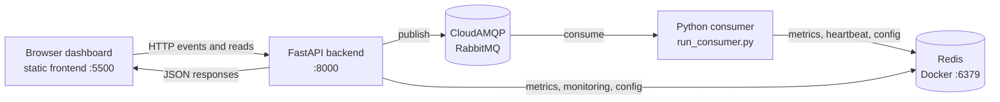

# StreamPulse

**StreamPulse** is a real-time library analytics and streaming-window metrics
aggregator. It accepts library actions such as issuing, returning, and
reserving a book, sends them through RabbitMQ, measures consumer processing
latency, aggregates that latency in tumbling and sliding windows, stores the
latest summaries in Redis, and displays the results in a browser dashboard.

The application separates event transport from processing. RabbitMQ buffers
events between the API and the consumer, while windows turn an event stream
into useful summaries without requiring the dashboard to process every event
itself.

## What the application does

The complete event flow is:

```text
Library Dashboard
       |
       v
FastAPI Backend -- publishes --> RabbitMQ queue
                                      |
                                      v
                              Python Consumer
                                      |
                                      v
                         Tumbling and Sliding Windows
                                      |
                                      v
                                  Redis
                                      |
                                      v
                         FastAPI Metrics API
                                      |
                                      v
                              Frontend Dashboard
```
The dashboard submits `BOOK_ISSUED`, `BOOK_RETURNED`, or `BOOK_RESERVED`
actions. The FastAPI backend validates the student and book identifiers,
generates a UUID event ID, assigns the current UTC timestamp, and publishes
the event. The separate consumer validates the message again and measures its
own processing latency in milliseconds. It replaces any legacy event value
with that measured latency, updates both windows, and saves completed summaries
to Redis. The dashboard polls the API every 10 seconds for monitoring, recent
events, configuration, and metrics.

## Implemented features

- Manual library event submission for the three supported event types.
- Optional finite sample batches of 5, 8, or 10 randomly generated events.
- Strict request validation and UUID event ID generation.
- UTC timestamps generated by the API.
- Persistent RabbitMQ messages and a durable `streampulse.events` queue.
- Asynchronous RabbitMQ publishing and consumption using `aio-pika`.
- A single-active-consumer queue and consumer prefetch of one message.
- Tumbling aggregation over non-overlapping event groups.
- Sliding aggregation over the latest configured events.
- Count, sum, average, minimum, and maximum latency metrics.
- Redis storage for the latest tumbling and sliding summaries.
- Consumer heartbeat, processing counters, failure counters, and status
  monitoring.
- Persisted active and pending window configuration.
- A browser dashboard with live metric cards, charts, recent events, service
  status, and configuration controls.
- Automated unit, API, integration, and consumer tests.

The project does **not** currently implement authentication, durable window
checkpoints, a dead-letter exchange configuration, exactly-once processing, or
time-based windows. Those are possible future improvements, not current
features.

## Technology stack

| Technology | Purpose |
|---|---|
| Python | Backend, consumer, event validation, and processing logic |
| FastAPI | HTTP API for events, health, monitoring, configuration, and metrics |
| RabbitMQ / CloudAMQP | Message broker between the API and consumer |
| `aio-pika` | Asynchronous RabbitMQ client |
| Redis | Latest metrics, monitoring state, heartbeat, and window configuration |
| HTML | Dashboard structure |
| CSS | Dashboard styling and responsive layout |
| JavaScript | Dashboard API calls, refreshes, forms, and rendering |
| Chart.js | Dashboard charts, loaded by the frontend page |
| Docker | Local Redis runtime |
| Pytest | Automated test runner |

## Project structure

```text
StreamPulse/
├── app/
│   ├── api/
│   ├── messaging/
│   │   └── rabbitmq.py
│   ├── processing/
│   │   ├── event_processor.py
│   │   ├── metrics.py
│   │   ├── window_config.py
│   │   └── window_manager.py
│   ├── storage/
│   │   └── redis_metrics.py
│   ├── main.py
│   └── schemas.py
├── frontend/
│   ├── app.js
│   ├── index.html
│   └── styles.css
├── tests/
│   ├── test_api.py
│   ├── test_consumer_runner.py
│   ├── test_integrations.py
│   ├── test_processing.py
│   └── test_window_config.py
├── .env.example
├── pytest.ini
├── requirements.txt
├── requirements-dev.txt
├── run_consumer.py
└── README.md
```

The `.venv`, `__pycache__`, `.pytest_cache`, `.env`, `.git`, and editor
directories are intentionally omitted.

| Path | Responsibility |
|---|---|
| `app/main.py` | Creates the FastAPI application and defines HTTP routes |
| `app/schemas.py` | Validates event types and event fields |
| `app/messaging/rabbitmq.py` | RabbitMQ settings, publisher, consumer, acknowledgements, and heartbeat |
| `app/processing/event_processor.py` | Connects windows to Redis and activates pending configuration |
| `app/processing/metrics.py` | Calculates count, sum, average, minimum, and maximum |
| `app/processing/window_config.py` | Validates supported window sizes and intervals |
| `app/processing/window_manager.py` | In-memory tumbling and sliding window implementations |
| `app/storage/redis_metrics.py` | Redis metrics, monitoring, heartbeat, and configuration persistence |
| `frontend/` | Static dashboard files |
| `run_consumer.py` | Builds and runs the separate RabbitMQ consumer process |
| `tests/` | API, processing, integration, consumer, and configuration tests |
| `requirements.txt` | Runtime Python dependencies |
| `requirements-dev.txt` | Runtime dependencies plus test dependencies |
| `.env.example` | Names of the required environment variables |

## Prerequisites

The repository does not pin a Python version in a manifest. Use a currently
supported Python 3 installation compatible with the listed FastAPI, Redis,
`aio-pika`, and Uvicorn dependencies, and verify it locally:

```powershell
python --version
python -m pip --version
```

You also need:

- VS Code (recommended for the terminal-by-terminal workflow below).
- Docker Desktop with Docker Engine running.
- A CloudAMQP RabbitMQ instance and its AMQP or AMQPS connection URL.
- Git, if cloning rather than downloading the repository.

Verify the external tools:

```powershell
docker --version
docker ps
git --version
```

## Windows setup

### 1. Get and open the project

Clone the repository or download it, then open the project folder in VS Code:

```powershell
git clone <repository-url>
Set-Location .\StreamPulse
code .
```

If you downloaded an archive, open the extracted `StreamPulse` folder instead.
The repository does not specify a public clone URL, so replace
`<repository-url>` with the URL you use.

### 2. Create and activate a virtual environment

In the VS Code integrated PowerShell terminal:

```powershell
python -m venv .venv
.venv\Scripts\Activate.ps1
```

If PowerShell blocks activation, allow it only for the current process and
activate again. This does not make a permanent execution-policy change:

```powershell
Set-ExecutionPolicy -Scope Process -ExecutionPolicy Bypass
.venv\Scripts\Activate.ps1
```

### 3. Install dependencies

`requirements-dev.txt` includes both runtime requirements and test tools, so
install it once:

```powershell
python -m pip install --upgrade pip
python -m pip install -r requirements-dev.txt
```

### 4. Configure environment variables

Create a local `.env` from `.env.example` and replace its placeholders locally.
Do not commit `.env` or paste credentials into documentation.

Required variables:

| Variable | Meaning |
|---|---|
| `RABBITMQ_URL` | AMQP/AMQPS connection URL for CloudAMQP or another RabbitMQ broker |
| `RABBITMQ_QUEUE` | Queue name; defaults to `streampulse.events` when omitted |
| `REDIS_URL` | Redis connection URL, such as `redis://localhost:6379` for local Docker Redis |

The application reads environment variables with `os.getenv`; it does not
automatically load `.env`. Run the following safe, reusable snippet in **each
PowerShell terminal** that runs the backend or consumer:

```powershell
Get-Content .env | ForEach-Object {
    if ($_ -match '^\s*([^#=\s]+)\s*=\s*(.*)\s*$') {
        Set-Item -Path "Env:$($matches[1])" -Value $matches[2].Trim()
    }
}
```

Confirm that the required names are present without printing secret values:

```powershell
@("RABBITMQ_URL", "RABBITMQ_QUEUE", "REDIS_URL") | ForEach-Object {
    "{0}: {1}" -f $_, [bool](Get-Item "Env:$_" -ErrorAction SilentlyContinue)
}
```

### 5. Start Redis with Docker Desktop

1. Open Docker Desktop.
2. Wait until Docker Engine is running.
3. Open a new VS Code terminal.

Create and start the local Redis container:

```powershell
docker run -d --name streampulse-redis -p 6379:6379 redis:7-alpine
```

This downloads `redis:7-alpine` if necessary, creates a container named
`streampulse-redis`, maps local port `6379` to Redis port `6379`, and runs it
in the background.

Verify it:

```powershell
docker ps
docker exec -it streampulse-redis redis-cli ping
```

Expected output:

```text
PONG
```

For this local container, set:

```text
REDIS_URL=redis://localhost:6379
```

If the container already exists, do not run `docker run` again. Start it:

```powershell
docker start streampulse-redis
```

Stop and restart it as follows:

```powershell
docker stop streampulse-redis
docker start streampulse-redis
```

Inspect keys and values with the Redis CLI:

```powershell
docker exec -it streampulse-redis redis-cli scan 0
docker exec -it streampulse-redis redis-cli get streampulse:metrics:sliding
docker exec -it streampulse-redis redis-cli get streampulse:metrics:tumbling
```

The project does not provide or claim a Redis browser dashboard.

### 6. Configure CloudAMQP

This project uses RabbitMQ through the configured connection URL:

1. Create or open a CloudAMQP instance.
2. Open its connection details.
3. Copy the AMQP or AMQPS URL.
4. Put that URL in `RABBITMQ_URL` in the local `.env`.
5. Keep `RABBITMQ_QUEUE=streampulse.events` unless you intentionally use a
   different queue name.

CloudAMQP is the remote message broker. Redis is separate and runs locally
through Docker in the workflow above. If RabbitMQ is unavailable, event
publishing returns an error, the dashboard reports RabbitMQ as unavailable,
and the consumer cannot receive new events.

## Running the project: terminal-by-terminal

Keep all four terminals running. Redis runs as a Docker container; the
backend, consumer, and frontend each run in a separate VS Code terminal.

| Terminal | Component | Command | Purpose |
|---|---|---|---|
| 1 | Redis | `docker start streampulse-redis` (or the `docker run` command above) | Stores metrics and monitoring state |
| 2 | FastAPI backend | `python -m uvicorn app.main:app --reload` | Validates and publishes events; serves API data |
| 3 | RabbitMQ consumer | `python run_consumer.py` | Processes events and writes window summaries |
| 4 | Frontend | `python -m http.server 5500 --directory frontend` | Serves the static dashboard |

### Terminal 1: Redis

Start Docker Desktop, then run the Redis command from the project terminal and
verify `PONG` as described above.

### Terminal 2: FastAPI backend

Choose **Terminal > New Terminal**, navigate to the project root, activate the
environment, load `.env`, and start FastAPI:

```powershell
Set-Location C:\path\to\StreamPulse
.venv\Scripts\Activate.ps1
# Run the .env loading snippet from the setup section.
python -m uvicorn app.main:app --reload
```

The backend must remain running. It is available at
[http://127.0.0.1:8000](http://127.0.0.1:8000/) and its Swagger documentation
is at [http://127.0.0.1:8000/docs](http://127.0.0.1:8000/docs).

### Terminal 3: RabbitMQ consumer

Choose **Terminal > New Terminal**, activate the same environment, load the
same variables, and run:

```powershell
Set-Location C:\path\to\StreamPulse
.venv\Scripts\Activate.ps1
# Run the .env loading snippet from the setup section.
python run_consumer.py
```

This process must remain running separately from the backend. It receives
RabbitMQ messages, measures consumer-side processing latency, calculates
window summaries, and writes them to Redis.

### Terminal 4: frontend

Choose **Terminal > New Terminal**, navigate to the project root, and serve
the static files:

```powershell
Set-Location C:\path\to\StreamPulse
python -m http.server 5500 --directory frontend
```

Open the dashboard at
[http://127.0.0.1:5500](http://127.0.0.1:5500/). The frontend and backend are
independent processes, so both must remain active.

## Using the dashboard

1. Open the dashboard and check API, RabbitMQ, Redis, and consumer status.
2. Enter a student ID and book ID.
3. Choose **Issue book**, **Return book**, or **Reserve book**.
4. The backend validates the action, generates its event ID and UTC timestamp,
   and publishes it to RabbitMQ.
5. The consumer receives the message and measures its processing latency.
6. The tumbling and sliding windows update according to their configuration.
7. Redis stores the newest available summaries.
8. The dashboard retrieves monitoring, events, configuration, and metrics data
   from the FastAPI API and refreshes every 10 seconds.

The **Generate Sample Events** control publishes a finite batch of 5, 8, or
10 random supported events at no more than 10 events per second.

## Window processing and metrics

The default persisted configuration is:

| Window | Default | Behavior |
|---|---:|---|
| Tumbling | 10 events | One non-overlapping summary after each complete group of 10 |
| Sliding | 5 events, interval 1 | Summary after every event over the latest 5 retained events |

The supported window sizes are 5, 8, and 10. The sliding interval must be a
positive integer smaller than the sliding size. A configuration submitted
through `PUT /api/config` is stored as pending and activates after the current
tumbling window completes.

The consumer uses its measured processing latency as each event's numeric
value. For values `2`, `4`, and `6` milliseconds:

- Count = `3`
- Sum = `2 + 4 + 6 = 12`
- Average = `12 / 3 = 4`
- Minimum = `2`
- Maximum = `6`

A tumbling window clears after producing its summary. A sliding window keeps a
bounded deque of the latest events, reports partial results before it is full,
and recalculates at the configured event interval.

## API reference

All routes are defined in `app/main.py`.

| Method | Endpoint | Purpose | Input / output |
|---|---|---|---|
| `GET` | `/api/health` | Reports API availability and configured service status | No input. Returns `status` and `services.rabbitmq` / `services.redis` |
| `GET` | `/api/monitoring` | Reports API, RabbitMQ queue, Redis, consumer, heartbeat, and window status | No input. Returns nested monitoring data; unavailable values may be `null` |
| `GET` | `/api/config` | Reads active and pending window configuration | No input. Returns `active`, `pending`, and `status` |
| `PUT` | `/api/config` | Validates and saves a pending configuration | JSON with `tumbling_size`, `sliding_size`, `sliding_interval`; returns active/pending configuration and activation message |
| `POST` | `/api/events` | Validates and publishes one library event | JSON with `event_type`, `student_id`, `book_id`; returns `202` and the published event |
| `POST` | `/api/events/batch` | Publishes a finite random sample batch | JSON `{ "batch_size": 5 }`, `8`, or `10`; returns requested, published, failed, and failure details |
| `GET` | `/api/events` | Returns recent successfully published events from this API process | No input. Returns `source`, `count`, and `events` |
| `GET` | `/api/metrics` | Reads the latest summaries from Redis | No input. Returns `tumbling` and `sliding`, each either a metric object or `null` |

### Submit one event

```powershell
Invoke-RestMethod `
  -Method Post `
  -Uri http://127.0.0.1:8000/api/events `
  -ContentType "application/json" `
  -Body '{"event_type":"BOOK_ISSUED","student_id":"STU-2048","book_id":"BK-0315"}'
```

The response has this shape:

```json
{
  "status": "published",
  "event": {
    "event_id": "generated-uuid",
    "event_type": "BOOK_ISSUED",
    "student_id": "STU-2048",
    "book_id": "BK-0315",
    "timestamp": "generated-utc-timestamp"
  }
}
```

The API accepts an optional legacy `value` field for compatibility, but does
not use it as the metric value. The consumer measures latency instead.

## Testing

Run the complete automated test suite from the activated virtual environment:

```powershell
python -m pytest -v
```

The tests cover event schema validation, metric calculations, tumbling and
sliding windows, configuration validation, API routes and error handling,
RabbitMQ publishing and consumption behavior, Redis integration behavior, and
consumer construction and shutdown.

## Troubleshooting

### Docker Desktop is not running

**Cause:** Docker Engine is unavailable.

```powershell
docker info
```

Start Docker Desktop, wait for the engine, then retry `docker start
streampulse-redis` or the `docker run` command.

### Redis connection refused

**Cause:** The container is stopped, the port is occupied, or `REDIS_URL` is
incorrect.

```powershell
docker ps
docker start streampulse-redis
docker exec -it streampulse-redis redis-cli ping
```

Use `REDIS_URL=redis://localhost:6379`, and check whether another process is
using port 6379 with `docker ps` or Docker Desktop.

### RabbitMQ / CloudAMQP connection failure

**Cause:** The URL is missing, malformed, expired, or inaccessible.

```powershell
Get-Item Env:RABBITMQ_URL
```

Copy the current AMQP/AMQPS URL from CloudAMQP into `.env`, load it again in
the backend and consumer terminals, and restart both processes.

### `RABBITMQ_URL` is missing

**Cause:** `.env` was not loaded into the current terminal.

```powershell
Get-Item Env:RABBITMQ_URL
```

Run the `.env` loading snippet from the setup section in that terminal.

### `REDIS_URL` is missing

**Cause:** `.env` was not loaded or the variable was omitted.

```powershell
Get-Item Env:REDIS_URL
```

Set and load `REDIS_URL=redis://localhost:6379` for the local container.

### Virtual environment activation fails

**Cause:** PowerShell execution policy or an incorrectly selected directory.

```powershell
Set-Location C:\path\to\StreamPulse
Set-ExecutionPolicy -Scope Process -ExecutionPolicy Bypass
.venv\Scripts\Activate.ps1
```

The policy command affects only the current PowerShell process.

### `ModuleNotFoundError`

**Cause:** The virtual environment is not active or dependencies were not
installed into it.

```powershell
.venv\Scripts\Activate.ps1
python -m pip install -r requirements-dev.txt
```

### Port 8000 is already in use

**Cause:** Another process is using the FastAPI port. The application frontend
is hard-coded to call port 8000, so stop the other process or update the
frontend and run command consistently.

```powershell
python -m uvicorn app.main:app --reload --port 8001
```

If you use another port, the current frontend will not connect until its
`API_BASE_URL` is changed in `frontend/app.js`.

### Port 5500 is already in use

**Cause:** Another static server is using the dashboard port.

```powershell
python -m http.server 5501 --directory frontend
```

The backend CORS configuration currently allows only ports 5500 on localhost
and 127.0.0.1, so use port 5500 or update the application CORS settings in a
separate code change.

### The frontend cannot connect to the backend

Confirm that the backend is running at
[http://127.0.0.1:8000/api/health](http://127.0.0.1:8000/api/health), that the
frontend is opened from port 5500, and that Terminal 2 has loaded its
environment. Browser developer tools can show the failed request.

### The consumer is not processing events

Confirm that Terminal 3 is still running, that it loaded the same
`RABBITMQ_URL` and `RABBITMQ_QUEUE` as the backend, and that monitoring reports
the consumer state. Check the dashboard or:

```powershell
Invoke-RestMethod http://127.0.0.1:8000/api/monitoring
```

### Metrics are not updating

The tumbling summary is not written until 10 events have completed with the
default configuration; the sliding summary should appear after the first
processed event. Confirm Redis responds with `PONG`, the consumer is running,
and the metrics endpoint responds:

```powershell
Invoke-RestMethod http://127.0.0.1:8000/api/metrics
```

## Important limitations

- The queue is configured for a single active consumer, and each consumer
  process owns its window state in memory.
- Window contents are lost if the consumer restarts. Persisted configuration
  survives because it is stored in Redis, but in-progress event contents do
  not.
- Delivery is at-least-once-oriented: messages are acknowledged after
  processing, and processing failures are rejected without requeue. No
  exactly-once guarantee is implemented.
- No dead-letter exchange is configured by this project, so rejected messages
  may be discarded by RabbitMQ unless the broker is configured separately.
- Recent events are stored only in the API process's bounded in-memory deque
  (100 events by default); they are not historical event storage.
- The API and consumer have no authentication or authorization layer.
- Monitoring uses a Redis heartbeat with a 30-second TTL. A stale heartbeat
  indicates that the last running snapshot expired; it is not proof of the
  exact failure cause.
- RabbitMQ queue inspection reports ready messages and consumer count, but
  unacknowledged message counts are explicitly unavailable.
- The repository does not define a production deployment configuration or
  pin a Python version.

## Proposed future scope

These are suggestions, not implemented functionality:

- Persistent window checkpoints and recovery of in-progress windows.
- A configured dead-letter exchange and durable failure inspection.
- More explicit retry and backoff policies.
- Multiple consumers and a scaling strategy.
- Authentication and authorization for the API and dashboard.
- More complete monitoring, alerting, and operational dashboards.
- Time-based tumbling or sliding windows in addition to event-count windows.

## Mermaid deployment and execution flow


